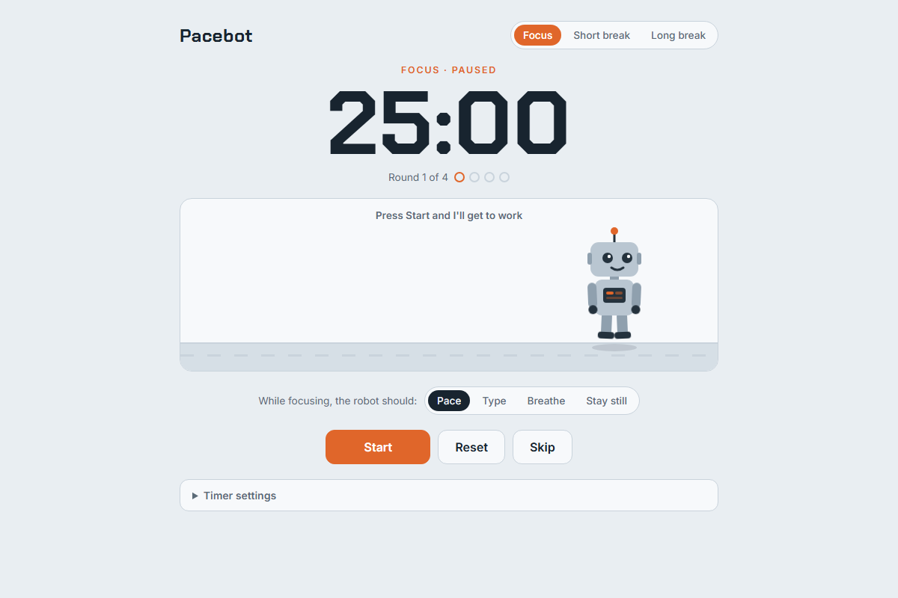

# Pacebot

A Pomodoro timer with a little robot that keeps pace with you. It works alongside you while you focus, then jumps and cheers when it's break time.

**Try it live: https://carolbult.github.io/pacebot/**

## Features

- Work, short break and long break sessions, with a long break after a set number of rounds
- An animated robot that changes what it's doing for each session. While you focus, you choose whether it paces, types, breathes or stays still
- A chime when each session ends
- Settings for session lengths, the number of rounds before a long break, and whether the next session starts automatically
- Start, pause, reset and skip controls
- Settings are saved in your browser, so they're still there next time

## Running it locally

Pacebot is a single `index.html` file with no build step or dependencies. Open it in any modern browser.
